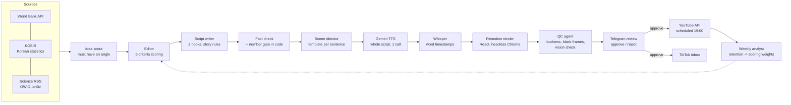

# Data-story video agents — an autonomous short-video studio on a free-tier ARM VM

A multi-agent pipeline that researches, writes, fact-checks, voices, animates and publishes a
data-driven short video every day (Vietnamese, YouTube Shorts + TikTok), plus a weekly 16:9
long-form compilation. A human approves every video from Telegram (~5 min/day); everything else
is automated. It runs on an Oracle Cloud free-tier ARM64 VM using only free-tier APIs.

**Numbers:** ~11.6k lines of Python/TypeScript (+4.5k lines of tests) · 320 unit tests ·
~105 commits · one 60–90 s video in ~15 min end-to-end on a 4-core ARM VM · $0/month model cost.

## Pipeline

Orchestration is plain Python + CrewAI for the LLM roles, scheduled by systemd user timers;
state lives in SQLite (idea pool, scripts, videos, asset-usage log, stats).

## Engineering decisions worth reading

**LLMs propose, code verifies.** Small free models fabricate numbers and drift from formats, so
every model output passes a deterministic gate:
- *Number gate* — every digit sequence in the narration must appear in the source article or
  data table (`crew.unsourced_numbers`); the LLM fact-checker alone had let three invented
  statistics through. Chart series are never copied by the model — code fills them from the
  source table (`crew.fill_series_from_data`).
- *Comparison gate* — the number gate cannot see a false sentence whose numbers are all real:
  "Korea in 2025 only reached the share Vietnam already had in 1990" (56.8% vs 74.7%) passed
  both the number gate and the LLM fact-checker — even when the checker read every sentence and
  was told to verify "A in year X equals B in year Y" claims. `src/claims.py` parses catch-up,
  higher/lower and "N times" sentences, resolves "today" to the table's latest year, and checks
  them against the source table; it found 4 such errors in 29 real data scripts with no false
  alarms. Root cause was a hook example in the prompt; the prompt now allows that hook only when
  the table carries a precomputed equivalence line.
- *Title gate* — a title that drops the unit of a ratio ("FDI 5× higher" when the data is
  FDI as % of GDP) is sent back for a rewrite (`metadata.title_drops_unit`, from a real mistake).
- *LLM-as-judge is constrained* — the vision QC model may only report three error classes as
  JSON, and code re-checks its claims against the digits the scene was allowed to show; free-form
  complaints never block a video.

**Designed around free-tier limits, measured in production.** Gemini TTS allows ~15 calls/day,
so the whole script is voiced in one call and split per sentence with forced alignment
(`audio/batch.py`); Whisper only supplies timestamps while subtitles use the script's own words
(Whisper mishears Vietnamese). Paid features the free tier lacks (search grounding) were
measured, documented and replaced by a second open data source for cross-checking.

**A rendering engine with a fallback.** Scenes moved from Manim to Remotion (React rendered by
headless Chrome on ARM64: 72 s of 1080×1920 video in ~4.5 min, 1.3 GB RAM). Python translates the
same scene spec into JSON props; any failure falls back to the Manim path so a morning never
ends without a video. Notable pieces:
- `ChartWorld` — one chart that lives across scenes: full-screen in trend scenes, docked under
  comparison scenes with the camera gliding to the year being discussed. A comparison is attached
  to a data point only when it matches exactly one real point; labels show real data points only,
  never interpolated values.
- Maps keep all geography in Python (projection, inset zoom, Vietnam's Paracel/Spratly islands as
  required by Vietnamese mapping law, with regression tests); React only colours and animates.
- File-size regressions are caught by measurement (an animated grain layer made a 31 s clip
  113 MB — over Telegram's 50 MB bot limit).

**Policy-aware content.** YouTube does not monetise templated or engagement-bait content, so the
system bans clickbait hook templates, forbids repeating the last 8 openings, alternates chart
layouts within a video, and rotates music/assets by a weekly usage log. Every asset (fonts,
icons, flags, music, map data) has a licence recorded in the asset table and checked at QC.

**Operations.** systemd timers (daily run, quota-retry run, weekly analyst, weekly long-form),
a long-running Telegram bot for approvals and OAuth renewal from a phone, idempotent state
transitions to prevent double uploads, and tools to replace a scheduled upload safely.

## Stack
Python 3.13 (uv, universal lock file) · CrewAI · Gemini (text, TTS, vision; free tier) · faster-whisper · Remotion
(React/TypeScript) · Manim · FFmpeg · SQLite · YouTube Data & Analytics APIs · TikTok Content
Posting API · Telegram Bot API · systemd · Oracle Cloud ARM64.

## Where to look
| Area | Files |
|---|---|
| Agents and gates | `src/crew.py`, `src/story.py`, `src/claims.py`, `src/second_source.py` |
| Audio | `src/audio/tts.py`, `src/audio/batch.py`, `src/audio/subtitles.py`, `src/audio/music.py` |
| Rendering | `src/render/web.py`, `src/render/web_map.py`, `render-web/src/` |
| QC and publishing | `src/qc.py`, `src/review.py`, `src/publish/` |
| Daily / weekly jobs | `src/daily.py`, `src/longform.py`, `src/analysis/weekly.py`, `deploy/` |
| Tests | `tests/` (`python -m unittest discover -s tests`) |
