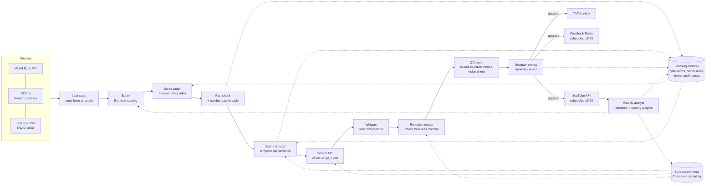

# Data-story video agents — an autonomous short-video studio on a free-tier ARM VM

A multi-agent pipeline that researches, writes, fact-checks, voices, animates and publishes a
data-driven short video every day (Vietnamese, YouTube Shorts + TikTok), plus a weekly 16:9
long-form compilation. A human approves every video from Telegram (~5 min/day); everything else
is automated. It runs on an Oracle Cloud free-tier ARM64 VM using only free-tier APIs.

**Numbers:** ~15k lines of Python/TypeScript (+6.5k lines of tests) · 439 unit tests ·
~120 commits · one 45–60 s video in ~15 min end-to-end on a 4-core ARM VM · $0/month model cost.

## Pipeline

Orchestration is plain Python + CrewAI for the LLM roles, scheduled by systemd user timers;
state lives in SQLite (idea pool, scripts, videos, asset-usage log, stats).

## Engineering decisions worth reading

**LLMs propose, code verifies.** Small free models fabricate numbers and drift from formats, so
every model output passes a deterministic gate:
- *Number gate* — every digit sequence in the narration must appear in the source article or
  data table (`crew.unsourced_numbers`); the LLM fact-checker alone had let three invented
  statistics through. Chart series are never copied by the model — code fills them from the
  source table (`crew.fill_series_from_data`).
- *Comparison gate* — the number gate cannot see a false sentence whose numbers are all real:
  "Korea in 2025 only reached the share Vietnam already had in 1990" (56.8% vs 74.7%) passed
  both the number gate and the LLM fact-checker — even when the checker read every sentence and
  was told to verify "A in year X equals B in year Y" claims. `src/claims.py` parses catch-up,
  higher/lower and "N times" sentences, resolves "today" to the table's latest year, and checks
  them against the source table; it found 4 such errors in 29 real data scripts with no false
  alarms. Root cause was a hook example in the prompt; the prompt now allows that hook only when
  the table carries a precomputed equivalence line.
- *Title gate* — a title that drops the unit of a ratio ("FDI 5× higher" when the data is
  FDI as % of GDP) is sent back for a rewrite (`metadata.title_drops_unit`, from a real mistake).
- *LLM-as-judge is constrained* — the vision QC model may only report three error classes as
  JSON, and code re-checks its claims against the digits the scene was allowed to show; free-form
  complaints never block a video.

**Agents that learn — without loosening a single gate** (`src/learning.py`). Learning only changes
prompts and priorities, stored as data (an events table + a YAML file), never code or gates:
- *Own mistakes* — every gate rejection is classified (matching on the gates' real messages, with
  tests that fail if a gate's wording drifts); before each run the writer and the scene director
  each read their own five most frequent mistakes of the last 14 days with a real example.
  Backfilled from saved fact-check records, the first lessons were exactly the failures seen in
  testing (reading the table out loud, numbers spelled as words).
- *The owner* — approvals, rejections and reply notes are recorded; durable rules are taught from
  Telegram (`/hoc`, listed with `/luat`, removed with `/quen`).
- *Viewers* — the weekly analyst scores hook type / topic family / video format by retention,
  shrunk toward the mean (a handful of videos proves nothing) plus a UCB-style exploration bonus so
  untried styles keep getting tried. It reorders the daily candidates and breaks ties between hook
  options — capped below one rule point, so a liked style never beats a hook that follows the rules.
- *Exemplars* — owner-approved scripts that still pass today's gates show the pacing; the prompt
  forbids copying wording (templated content is demonetised).
- A broken memory degrades to "learned nothing" instead of stopping the pipeline.

**Production that experiments on itself** (`src/style.py`). Every new video gets a randomly assigned
combination of production "knobs" — narration speed, music level, max seconds per picture, caption
size — three levels each inside hard, on-brand limits (a factorial design: every video informs every
knob). The weekly analyst compares average view percentage per level, counting a video only for the
knobs that actually got their assigned level (a slow TTS day forces faster narration; an empty music
library means no music). Assignment then uses Thompson sampling with shrinkage, and when a neighbouring
level wins clearly the window itself moves one step — the style drifts toward what viewers watch
longer, never past the hard limits. The owner steers from Telegram (`/nhac nho` = "music quieter"),
and auto-drift is never allowed to move back against a direction the owner chose. Retention per scene
type and per opening-scene type feeds the scene director's prompt; QC failures are split into
"the model can fix this" (clipped titles, picture contradicts narration → prompt lessons) and
"code bug" (black frames, render fallback → weekly report only).

**Channel-level agents** (`src/community.py`, `src/growth.py`, `src/topics.py`). A community agent reads
new comments each morning, classifies them with a small model whose output is clamped by code (fixed
label set, topic keys must exist in the source catalog), puts "your number is wrong" comments at the top
of the owner's Telegram digest, drafts replies that may only contain numbers present in that video's
data table, and turns topic requests into either a link to an existing video or a priority slot in the
next idea run. A growth agent measures the whole channel (subscribers, Shorts vs long-form via the
Analytics `creatorContentType` dimension, YPP progress), blends subscribers-per-1,000-views into the
viewer-preference score, and detects breakout videos (views/day ≥ 2.5× the channel median) to boost that
topic family and format for ten days and queue the same indicator in another format. Nothing is posted
without the owner: each actionable comment arrives as its own Telegram message with ✅ Post / ❌ Skip
buttons, replying to that message turns the owner's text into a new draft that still needs ✅, and a
post happens exactly once (atomic `new → posting` transition). The `force-ssl` scope this needs was
added only after the owner agreed — YouTube has no narrower scope for posting comments.

**Agents that study the platform itself** (`src/yt_insights.py`, `src/yt_news.py`). One reads how YouTube
distributes the channel — traffic sources (measured: 98.6% of views come from the Shorts feed, so the
first seconds decide everything), the search terms viewers actually typed (filtered to on-topic terms by
matching the data catalog; "gdp việt nam" kept, lottery queries dropped) which then feed the title/tag
writer, per-video lifecycle (share of views in the first two days), and the channels YouTube places the
channel next to, which feed the competitor scan. The other reads YouTube's official blog and creator
channels over RSS; a small model filters and summarises, and code re-checks every "high impact" verdict
against the original post (the model once flagged a TV co-viewing change as urgent). Neither changes any
rule of the system on its own.

**Learning from big channels without copying them** (`src/analysis/big_channels.py`). Weekly, the agent
finds large channels in the niche (search by view count, then a code filter: ≥ 30% of recent Shorts titles
must be about data/countries/rankings — the first live run surfaced a 48.8M-subscriber cooking channel
that slipped through on "vs" titles), finds each channel's outliers (≥ 3× its own median), and has Gemini
*watch* the outlier videos through the API's YouTube-URL input (~2.7k tokens per Short on the free tier)
against a fixed schema — opening line, hook type, cuts, on-screen text, ending. Code, not the model,
aggregates the "playbook" (measured: outliers run ~31 s with a cut every ~1.4 s). The writer and title
agents read structure, never wording, and a similarity gate sends back any title too close to a big
channel's. Matching outlier topics to the channel's own data catalog had to move from single Vietnamese
syllables to two-syllable compounds after live false matches ("quốc gia" vs "tham gia").

**A second platform with its own learning loop** (`src/publish/facebook.py`, `src/fb_insights.py`).
Approved videos are also published as Facebook Reels (three-step Reels Publishing API, AI-content label,
one-time lock + retry button). A weekly agent reads Reel and Page insights (avoiding Page metrics Meta has
deprecated), tracks the posting cadence the Content Monetization program asks for, and reuses the YouTube
preference learner on Facebook data under a separate key, so the daily script ranking blends both
audiences (Facebook at half weight). Posting time is a Thompson-sampling experiment over three time slots,
seeded per video so a retry never moves a Reel to another slot. Facebook comments flow through the same
approve-before-posting community cards as YouTube.

**One codebase, two language channels** (`src/lang.py`, `src/claims_ko.py`, `config/channel_ko.yaml`). A
Korean-language channel runs from the same code with its own config, data, tokens and schedule. Everything the
code writes for the model (data summaries, computed "story beats") has paired Vietnamese/Korean text, number
formats follow the audience (Vietnamese `1.234,5` vs Korean `1,234.5` — a Korean reader would take a
Vietnamese-formatted "2.462" as two-point-four, a 1000× error the digit-matching gate cannot see), large-number
gates also try Korean 10,000-based units (만/억), and Korean particles are chosen by the final consonant. The
fact gates were rewritten for Korean's subject–object–verb order ("A는 B보다 높다", "A는 B의 N배") rather than
translated pattern-for-pattern, with the error messages kept identical so the learning memory still classifies
them. Maps follow each audience's official viewpoint, built from Natural Earth's per-country worldview columns:
the Vietnamese channel draws the Paracel/Spratly islands as Vietnamese; the Korean channel uses the Korean
worldview (Kosovo recognised), draws Dokdo, labels the East Sea "동해", and swaps the South China Sea inset for a
Korean peninsula inset — with regression tests on both sides. Measured before tuning: Korean narration runs ~1 word-phrase per second because numbers are read out in
full, so the word budget is per-language config, not a constant.

**Designed around free-tier limits, measured in production.** Gemini TTS allows ~15 calls/day,
so the whole script is voiced in one call and split per sentence with forced alignment
(`audio/batch.py`); Whisper only supplies timestamps while subtitles use the script's own words
(Whisper mishears Vietnamese). Paid features the free tier lacks (search grounding) were
measured, documented and replaced by a second open data source for cross-checking.

**A rendering engine with a fallback.** Scenes moved from Manim to Remotion (React rendered by
headless Chrome on ARM64: 72 s of 1080×1920 video in ~4.5 min, 1.3 GB RAM). Python translates the
same scene spec into JSON props; any failure falls back to the Manim path so a morning never
ends without a video. Notable pieces:
- `ChartWorld` — one chart that lives across scenes: full-screen in trend scenes, docked under
  comparison scenes with the camera gliding to the year being discussed. A comparison is attached
  to a data point only when it matches exactly one real point; labels show real data points only,
  never interpolated values.
- Maps keep all geography in Python (projection, inset zoom, Vietnam's Paracel/Spratly islands as
  required by Vietnamese mapping law, with regression tests); React only colours and animates.
- File-size regressions are caught by measurement (an animated grain layer made a 31 s clip
  113 MB — over Telegram's 50 MB bot limit).

**Policy-aware content.** YouTube does not monetise templated or engagement-bait content, so the
system bans clickbait hook templates, forbids repeating the last 8 openings, alternates chart
layouts within a video, and rotates music/assets by a weekly usage log. Every asset (fonts,
icons, flags, music, map data) has a licence recorded in the asset table and checked at QC.

**Operations.** systemd timers (daily run, quota-retry run, weekly analyst, weekly long-form),
a long-running Telegram bot for approvals and OAuth renewal from a phone, idempotent state
transitions to prevent double uploads, and tools to replace a scheduled upload safely.

## Stack
Python 3.13 (uv, universal lock file) · CrewAI · Gemini (text, TTS, vision; free tier) · faster-whisper · Remotion
(React/TypeScript) · Manim · FFmpeg · SQLite · YouTube Data & Analytics APIs · Facebook Reels Publishing API · TikTok Content
Posting API · Telegram Bot API · systemd · Oracle Cloud ARM64.

## Where to look
| Area | Files |
|---|---|
| Agents and gates | `src/crew.py`, `src/story.py`, `src/claims.py`, `src/second_source.py` |
| Self-learning | `src/learning.py`, `src/style.py`, `tests/test_learning.py`, `tests/test_style.py` |
| Channel growth | `src/community.py`, `src/growth.py`, `src/topics.py`, `tests/test_channel_agents.py` |
| Platform analysis | `src/yt_insights.py`, `src/yt_news.py`, `tests/test_yt_agents.py` |
| Learning from big channels | `src/analysis/big_channels.py`, `tests/test_big_channels.py` |
| Facebook Reels | `src/publish/facebook.py`, `src/fb_insights.py`, `tests/test_facebook.py`, `tests/test_fb_agents.py` |
| Audio | `src/audio/tts.py`, `src/audio/batch.py`, `src/audio/subtitles.py`, `src/audio/music.py` |
| Rendering | `src/render/web.py`, `src/render/web_map.py`, `render-web/src/` |
| QC and publishing | `src/qc.py`, `src/review.py`, `src/publish/` |
| Daily / weekly jobs | `src/daily.py`, `src/longform.py`, `src/analysis/weekly.py`, `deploy/` |
| Tests | `tests/` (`python -m unittest discover -s tests`) |
